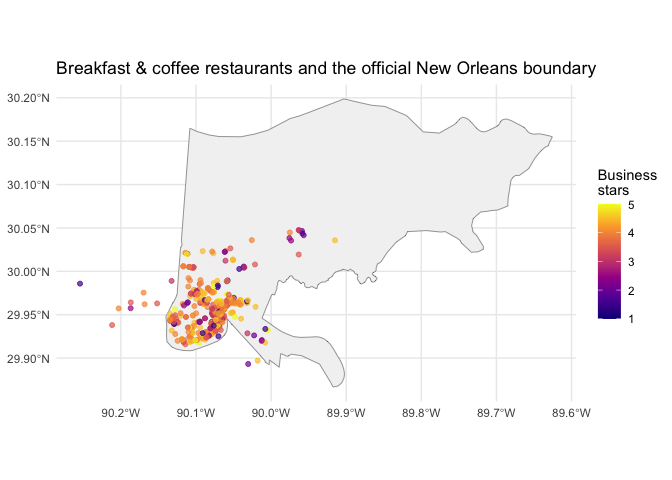
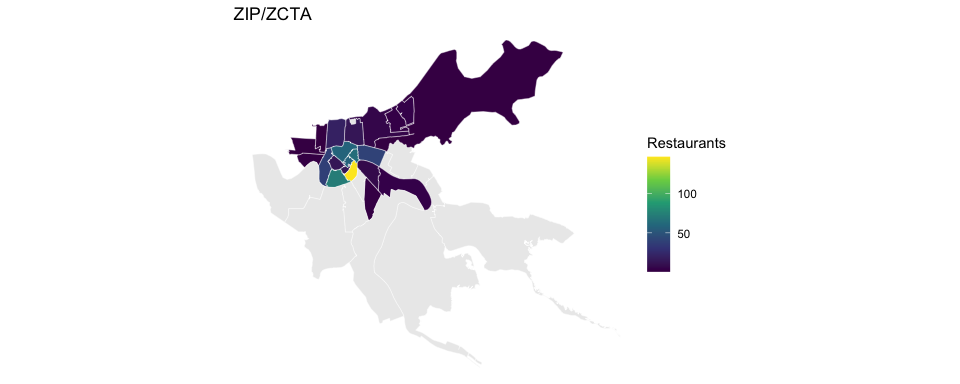
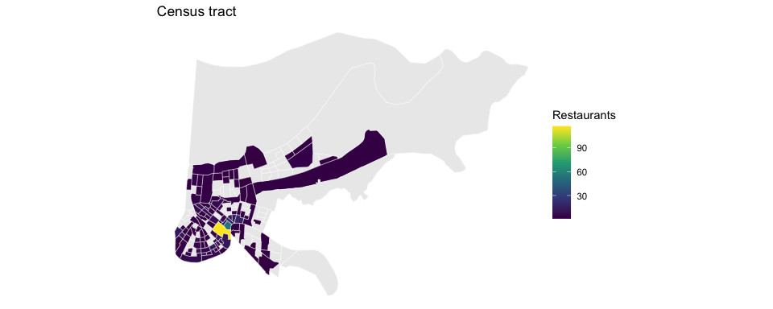
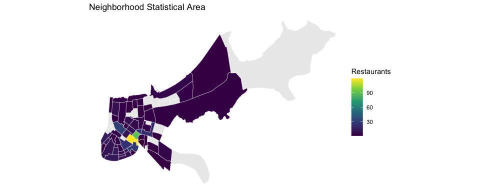
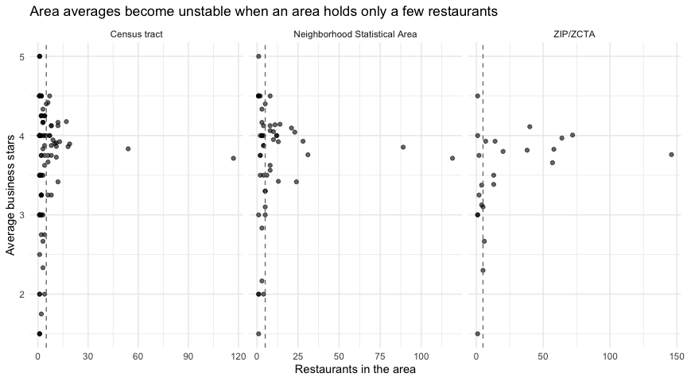

# Breakfast & Coffee in New Orleans — Steps 3–6


- [Step 3: Select related restaurant
  categories](#step-3-select-related-restaurant-categories)
  - [Individual categories](#individual-categories)
  - [Categories that appear together](#categories-that-appear-together)
  - [Inclusion rule](#inclusion-rule)
- [Step 4: Join businesses to
  reviews](#step-4-join-businesses-to-reviews)
- [Step 5: Spatial join to official place
  boundaries](#step-5-spatial-join-to-official-place-boundaries)
- [Step 6: Compare geographic
  systems](#step-6-compare-geographic-systems)
  - [Comparison table](#comparison-table)
  - [Areas per system](#areas-per-system)
  - [Maps](#maps)
  - [Which geographic system, and why](#which-geographic-system-and-why)

This file covers Steps 3–6 of the project: choosing the restaurant
categories, joining businesses to reviews, the spatial join to an
official boundary, and the comparison of geographic systems. Steps 1–2
(import and New Orleans filter) are in [`R/import.R`](R/import.R) and
[`R/clean_filter.R`](R/clean_filter.R).

``` r
library(tidyverse)
library(sf)
library(tigris)
options(tigris_use_cache = TRUE)
sf_use_s2(FALSE)

dir.create("figures", showWarnings = FALSE)

restaurants <- readRDS("data/new_orleans/business_new_orleans.rds")
reviews     <- readRDS("data/new_orleans/reviews_new_orleans.rds")
```

## Step 3: Select related restaurant categories

### Individual categories

One row per business–category pair, with capitalization and whitespace
cleaned. `restaurants` and `food` are dropped from the counts because
every business in this table already carries them.

``` r
restaurant_categories <- restaurants |>
  select(business_id, categories) |>
  separate_rows(categories, sep = ",") |>
  mutate(category = str_to_lower(str_squish(categories))) |>
  filter(category != "") |>
  distinct(business_id, category)

category_counts <- restaurant_categories |>
  filter(!category %in% c("restaurants", "food")) |>
  count(category, sort = TRUE, name = "restaurants")

knitr::kable(head(category_counts, 25))
```

| category                  | restaurants |
|:--------------------------|------------:|
| nightlife                 |         540 |
| bars                      |         508 |
| cajun/creole              |         401 |
| breakfast & brunch        |         367 |
| sandwiches                |         354 |
| seafood                   |         331 |
| american (new)            |         323 |
| american (traditional)    |         299 |
| coffee & tea              |         208 |
| burgers                   |         202 |
| cafes                     |         173 |
| pizza                     |         172 |
| cocktail bars             |         160 |
| event planning & services |         156 |
| southern                  |         155 |
| fast food                 |         142 |
| mexican                   |         124 |
| salad                     |         124 |
| italian                   |         121 |
| chicken wings             |         112 |
| specialty food            |         108 |
| arts & entertainment      |          86 |
| french                    |          86 |
| bakeries                  |          81 |
| desserts                  |          73 |

### Categories that appear together

``` r
selected_categories <- c("breakfast & brunch", "coffee & tea", "cafes", "bakeries")

category_pairs <- restaurant_categories |>
  filter(category %in% selected_categories) |>
  inner_join(
    restaurant_categories |> filter(category %in% selected_categories),
    by = "business_id",
    suffix = c("_1", "_2"),
    relationship = "many-to-many"
  ) |>
  filter(category_1 < category_2) |>
  count(category_1, category_2, sort = TRUE, name = "restaurants_with_both")

knitr::kable(category_pairs)
```

| category_1         | category_2         | restaurants_with_both |
|:-------------------|:-------------------|----------------------:|
| breakfast & brunch | coffee & tea       |                    85 |
| cafes              | coffee & tea       |                    75 |
| breakfast & brunch | cafes              |                    65 |
| bakeries           | coffee & tea       |                    37 |
| bakeries           | breakfast & brunch |                    32 |
| bakeries           | cafes              |                    16 |

``` r
# Which other categories most often sit next to the selected four?
neighbours <- restaurant_categories |>
  semi_join(
    restaurant_categories |> filter(category %in% selected_categories),
    by = "business_id"
  ) |>
  filter(!category %in% c(selected_categories, "restaurants", "food")) |>
  count(category, sort = TRUE, name = "restaurants")

knitr::kable(head(neighbours, 10))
```

| category               | restaurants |
|:-----------------------|------------:|
| sandwiches             |         126 |
| nightlife              |         101 |
| american (new)         |          95 |
| american (traditional) |          93 |
| bars                   |          91 |
| cajun/creole           |          88 |
| burgers                |          56 |
| southern               |          49 |
| salad                  |          43 |
| seafood                |          42 |

### Inclusion rule

A restaurant is included if it belongs to **at least one** of the four
selected categories.

``` r
selected_ids <- restaurant_categories |>
  filter(category %in% selected_categories) |>
  distinct(business_id)

breakfast_coffee <- restaurants |>
  semi_join(selected_ids, by = "business_id")

tibble(
  qualifying_restaurants = nrow(breakfast_coffee),
  mean_business_stars    = round(mean(breakfast_coffee$stars), 2),
  median_review_count    = median(breakfast_coffee$review_count)
) |> knitr::kable()
```

| qualifying_restaurants | mean_business_stars | median_review_count |
|-----------------------:|--------------------:|--------------------:|
|                    575 |                3.79 |                  75 |

## Step 4: Join businesses to reviews

Reviews are filtered to the selected restaurants **before** the join, so
reviews for unrelated businesses are not carried forward.

``` r
breakfast_coffee_reviews <- reviews |>
  semi_join(breakfast_coffee, by = "business_id") |>
  left_join(
    breakfast_coffee |> select(business_id, business_name, business_stars = stars),
    by = "business_id"
  )

tibble(
  reviews_kept          = nrow(breakfast_coffee_reviews),
  restaurants_reviewed  = n_distinct(breakfast_coffee_reviews$business_id),
  distinct_reviewers    = n_distinct(breakfast_coffee_reviews$user_id),
  mean_review_stars     = round(mean(breakfast_coffee_reviews$stars), 2)
) |> knitr::kable()
```

| reviews_kept | restaurants_reviewed | distinct_reviewers | mean_review_stars |
|-------------:|---------------------:|-------------------:|------------------:|
|       159552 |                  575 |              97950 |              4.01 |

``` r
# Per-restaurant review summary, used in Step 6
review_summary <- breakfast_coffee_reviews |>
  group_by(business_id) |>
  summarise(
    reviews_in_data   = n(),
    mean_review_stars = mean(stars),
    .groups = "drop"
  )
```

## Step 5: Spatial join to official place boundaries

``` r
louisiana_places <- tigris::places(state = "LA", cb = TRUE, year = 2024, class = "sf")

restaurant_points <- breakfast_coffee |>
  filter(!is.na(longitude), !is.na(latitude)) |>
  left_join(review_summary, by = "business_id") |>
  st_as_sf(coords = c("longitude", "latitude"), crs = 4326, remove = FALSE) |>
  st_transform(st_crs(louisiana_places))

restaurants_with_place <- restaurant_points |>
  st_join(louisiana_places |> select(GEOID, place_name = NAME),
          join = st_within, left = TRUE)

restaurants_with_place |>
  st_drop_geometry() |>
  count(city, place_name, sort = TRUE) |>
  knitr::kable()
```

| city        | place_name  |   n |
|:------------|:------------|----:|
| New Orleans | New Orleans | 564 |
| New Orleans | Elmwood     |   2 |
| New Orleans | Harahan     |   2 |
| New Orleans | Jefferson   |   2 |
| New Orleans | Metairie    |   2 |
| New Orleans | Terrytown   |   2 |
| New Orleans | Kenner      |   1 |

``` r
# Restaurants whose Yelp city is "New Orleans" but whose point is not inside
# the official New Orleans polygon — inspected, not deleted.
restaurants_with_place |>
  st_drop_geometry() |>
  filter(is.na(place_name) | place_name != "New Orleans") |>
  select(business_name, address, postal_code, latitude, longitude, place_name) |>
  knitr::kable()
```

| business_name | address | postal_code | latitude | longitude | place_name |
|:---|:---|:---|---:|---:|:---|
| Dots Diner | 2317 Jefferson Hwy | 70121 | 29.96304 | -90.15171 | Jefferson |
| Bagels & Bytes | 1001 Metairie Rd | 70005 | 29.98898 | -90.13247 | Metairie |
| Dejepe Bakery | 775 Berhman Hwy | 70056 | 29.89703 | -90.01797 | Terrytown |
| City Greens | 5161 Citrus Blvd | 70123 | 29.96416 | -90.18689 | Elmwood |
| Hickory Cafe & Grill | 1313 Hickory Ave | 70123 | 29.95724 | -90.20298 | Harahan |
| Pelican Cafe | 3901 Airline Dr | 70001 | 29.97545 | -90.16979 | Metairie |
| Wow Cafe | 5359 Mounes St | 70123 | 29.95745 | -90.18701 | Elmwood |
| Dunkin’ Donuts | 857 Terry Pkwy | 70056 | 29.89320 | -90.03053 | Terrytown |
| Breakfast Club Cafe | 8321 Jefferson Hwy | 70123 | 29.93806 | -90.21169 | Harahan |
| Haydel’s Bakery | 4037 Jefferson Hwy | 70121 | 29.96207 | -90.16834 | Jefferson |
| Le Petit Bistro |  | 70115 | 29.98579 | -90.25440 | Kenner |

``` r
new_orleans_boundary <- louisiana_places |> filter(NAME == "New Orleans")

p <- ggplot() +
  geom_sf(data = new_orleans_boundary, fill = "grey95", color = "grey35") +
  geom_sf(data = restaurants_with_place, aes(color = stars), alpha = 0.7, size = 1.4) +
  scale_color_viridis_c(option = "C", limits = c(1, 5)) +
  labs(title = "Breakfast & coffee restaurants and the official New Orleans boundary",
       color = "Business\nstars") +
  theme_minimal()
ggsave("figures/step5_points_on_boundary.png", p, width = 8, height = 6, dpi = 150)
p
```



## Step 6: Compare geographic systems

Three systems are tested: ZIP Code Tabulation Areas, Census tracts, and
the City of New Orleans Neighborhood Statistical Areas. (Wards were
considered, but the City’s ward layer metadata restricts redistribution
outside its GIS department, so they are left out.)

``` r
# ZCTAs: national file filtered to New Orleans-area ZIP prefixes
zctas <- tigris::zctas(cb = TRUE, year = 2020, starts_with = c("700", "701"), class = "sf") |>
  transmute(area_name = ZCTA5CE20)

# Census tracts in Orleans Parish
tracts <- tigris::tracts(state = "LA", county = "Orleans", cb = TRUE, year = 2024, class = "sf") |>
  transmute(area_name = NAMELSAD)

# Neighborhood Statistical Areas (data.nola.gov, dataset exvn-jeh2)
nsa <- st_read("data/boundaries/nsa.geojson", quiet = TRUE)
nsa_name_col <- intersect(c("gnocdc_lab", "GNOCDC_LAB", "name", "NAME", "lup_lab"), names(nsa))[1]
nsa <- nsa |> transmute(area_name = .data[[nsa_name_col]])

systems <- list(
  "ZIP/ZCTA"                       = zctas,
  "Census tract"                   = tracts,
  "Neighborhood Statistical Area"  = nsa
)
```

``` r
assign_areas <- function(boundaries, points) {
  points |>
    st_transform(st_crs(boundaries)) |>
    st_join(boundaries, join = st_within, left = TRUE)
}

summarise_areas <- function(assigned) {
  assigned |>
    st_drop_geometry() |>
    filter(!is.na(area_name)) |>
    group_by(area_name) |>
    summarise(
      number_of_restaurants   = n(),
      average_business_stars  = mean(stars, na.rm = TRUE),
      median_business_stars   = median(stars, na.rm = TRUE),
      mean_review_stars       = mean(mean_review_stars, na.rm = TRUE),
      total_reviews           = sum(reviews_in_data, na.rm = TRUE),
      .groups = "drop"
    ) |>
    arrange(desc(number_of_restaurants))
}

assigned  <- map(systems, assign_areas, points = restaurant_points)
summaries <- map(assigned, summarise_areas)
```

### Comparison table

``` r
comparison <- imap_dfr(summaries, \(s, system) {
  a <- assigned[[system]]
  tibble(
    `Geographic system`              = system,
    `Areas in boundary file`         = nrow(systems[[system]]),
    `Areas with ≥1 restaurant`       = nrow(s),
    `Restaurants assigned`           = sum(!is.na(a$area_name)),
    `Unmatched restaurants`          = sum(is.na(a$area_name)),
    `Smallest area count`            = min(s$number_of_restaurants),
    `Largest area count`             = max(s$number_of_restaurants),
    `Median area count`              = median(s$number_of_restaurants),
    `Areas with < 5 restaurants`     = sum(s$number_of_restaurants < 5),
    `Areas with ≥ 10 restaurants`    = sum(s$number_of_restaurants >= 10)
  )
})

write_csv(comparison, "figures/step6_geography_comparison.csv")
knitr::kable(comparison)
```

| Geographic system | Areas in boundary file | Areas with ≥1 restaurant | Restaurants assigned | Unmatched restaurants | Smallest area count | Largest area count | Median area count | Areas with \< 5 restaurants | Areas with ≥ 10 restaurants |
|:---|---:|---:|---:|---:|---:|---:|---:|---:|---:|
| ZIP/ZCTA | 67 | 24 | 575 | 0 | 1 | 146 | 6.5 | 9 | 11 |
| Census tract | 184 | 103 | 564 | 11 | 1 | 117 | 2.0 | 75 | 13 |
| Neighborhood Statistical Area | 72 | 54 | 564 | 11 | 1 | 119 | 4.0 | 28 | 15 |

### Areas per system

``` r
for (system in names(summaries)) {
  cat("\n\n####", system, "— top 12 by restaurant count\n\n")
  print(knitr::kable(
    summaries[[system]] |>
      slice_head(n = 12) |>
      mutate(across(where(is.double), \(x) round(x, 2)))
  ))
}
```

#### ZIP/ZCTA — top 12 by restaurant count

| area_name | number_of_restaurants | average_business_stars | median_business_stars | mean_review_stars | total_reviews |
|:---|---:|---:|---:|---:|---:|
| 70130 | 146 | 3.76 | 4.0 | 3.77 | 78261 |
| 70115 | 72 | 4.01 | 4.0 | 4.00 | 14520 |
| 70116 | 64 | 3.97 | 4.0 | 3.96 | 21715 |
| 70119 | 58 | 3.83 | 4.0 | 3.83 | 10782 |
| 70112 | 57 | 3.66 | 4.0 | 3.66 | 10314 |
| 70117 | 40 | 4.11 | 4.5 | 4.11 | 7460 |
| 70118 | 38 | 3.82 | 4.0 | 3.82 | 6569 |
| 70124 | 20 | 3.80 | 4.0 | 3.83 | 3164 |
| 70113 | 14 | 3.93 | 4.0 | 3.90 | 2962 |
| 70122 | 13 | 3.50 | 3.5 | 3.48 | 712 |
| 70125 | 13 | 3.38 | 3.5 | 3.44 | 838 |
| 70114 | 7 | 3.93 | 4.5 | 3.96 | 415 |

#### Census tract — top 12 by restaurant count

| area_name | number_of_restaurants | average_business_stars | median_business_stars | mean_review_stars | total_reviews |
|:---|---:|---:|---:|---:|---:|
| Census Tract 134 | 117 | 3.71 | 4.0 | 3.71 | 40890 |
| Census Tract 135.02 | 54 | 3.83 | 4.0 | 3.85 | 39040 |
| Census Tract 38 | 19 | 3.89 | 4.0 | 3.88 | 5993 |
| Census Tract 135.01 | 18 | 3.86 | 4.0 | 3.89 | 5023 |
| Census Tract 12 | 17 | 4.18 | 4.0 | 4.18 | 4056 |
| Census Tract 90 | 13 | 3.92 | 4.0 | 3.92 | 8652 |
| Census Tract 126 | 12 | 3.42 | 3.5 | 3.46 | 1498 |
| Census Tract 129 | 12 | 4.12 | 4.0 | 4.07 | 3636 |
| Census Tract 18 | 12 | 4.17 | 4.5 | 4.20 | 2071 |
| Census Tract 139 | 11 | 3.86 | 4.0 | 3.84 | 2068 |
| Census Tract 26 | 11 | 3.91 | 4.0 | 3.91 | 3906 |
| Census Tract 77 | 11 | 3.73 | 4.0 | 3.67 | 2110 |

#### Neighborhood Statistical Area — top 12 by restaurant count

| area_name | number_of_restaurants | average_business_stars | median_business_stars | mean_review_stars | total_reviews |
|:---|---:|---:|---:|---:|---:|
| CENTRAL BUSINESS DISTRICT | 119 | 3.71 | 4.0 | 3.72 | 42236 |
| FRENCH QUARTER | 89 | 3.85 | 4.0 | 3.86 | 48710 |
| MID-CITY | 31 | 3.76 | 4.0 | 3.77 | 5336 |
| LOWER GARDEN DISTRICT | 28 | 3.93 | 4.0 | 3.92 | 8556 |
| CENTRAL CITY | 24 | 3.42 | 3.5 | 3.41 | 3591 |
| MARIGNY | 23 | 4.04 | 4.0 | 4.06 | 5977 |
| BYWATER | 21 | 4.10 | 4.0 | 4.09 | 4385 |
| LEONIDAS | 14 | 4.14 | 4.0 | 4.11 | 3821 |
| EAST CARROLLTON | 13 | 3.42 | 3.5 | 3.45 | 1523 |
| GARDEN DISTRICT | 13 | 3.92 | 4.0 | 3.92 | 8652 |
| UPTOWN | 12 | 4.00 | 4.0 | 3.99 | 1802 |
| WEST RIVERSIDE | 12 | 4.00 | 4.0 | 4.07 | 1956 |

``` r
# Which restaurants fall outside each system?
imap_dfr(assigned, \(a, system) {
  a |> st_drop_geometry() |> filter(is.na(area_name)) |>
    transmute(system, business_name, address, postal_code)
}) |> knitr::kable()
```

| system | business_name | address | postal_code |
|:---|:---|:---|:---|
| Census tract | Dots Diner | 2317 Jefferson Hwy | 70121 |
| Census tract | Bagels & Bytes | 1001 Metairie Rd | 70005 |
| Census tract | Dejepe Bakery | 775 Berhman Hwy | 70056 |
| Census tract | City Greens | 5161 Citrus Blvd | 70123 |
| Census tract | Hickory Cafe & Grill | 1313 Hickory Ave | 70123 |
| Census tract | Pelican Cafe | 3901 Airline Dr | 70001 |
| Census tract | Wow Cafe | 5359 Mounes St | 70123 |
| Census tract | Dunkin’ Donuts | 857 Terry Pkwy | 70056 |
| Census tract | Breakfast Club Cafe | 8321 Jefferson Hwy | 70123 |
| Census tract | Haydel’s Bakery | 4037 Jefferson Hwy | 70121 |
| Census tract | Le Petit Bistro |  | 70115 |
| Neighborhood Statistical Area | Dots Diner | 2317 Jefferson Hwy | 70121 |
| Neighborhood Statistical Area | Bagels & Bytes | 1001 Metairie Rd | 70005 |
| Neighborhood Statistical Area | Dejepe Bakery | 775 Berhman Hwy | 70056 |
| Neighborhood Statistical Area | City Greens | 5161 Citrus Blvd | 70123 |
| Neighborhood Statistical Area | Hickory Cafe & Grill | 1313 Hickory Ave | 70123 |
| Neighborhood Statistical Area | Pelican Cafe | 3901 Airline Dr | 70001 |
| Neighborhood Statistical Area | Wow Cafe | 5359 Mounes St | 70123 |
| Neighborhood Statistical Area | Dunkin’ Donuts | 857 Terry Pkwy | 70056 |
| Neighborhood Statistical Area | Breakfast Club Cafe | 8321 Jefferson Hwy | 70123 |
| Neighborhood Statistical Area | Haydel’s Bakery | 4037 Jefferson Hwy | 70121 |
| Neighborhood Statistical Area | Le Petit Bistro |  | 70115 |

### Maps

Each map shows restaurant count per area (fill) for the system, with the
official New Orleans boundary outlined. Areas with no selected
restaurants are left blank.

``` r
map_one <- function(system) {
  b <- systems[[system]] |>
    left_join(summaries[[system]], by = "area_name") |>
    st_filter(st_transform(new_orleans_boundary, st_crs(systems[[system]])) |> st_buffer(0.02))
  ggplot(b) +
    geom_sf(aes(fill = number_of_restaurants), color = "white", linewidth = 0.15) +
    scale_fill_viridis_c(option = "D", na.value = "grey92", name = "Restaurants") +
    labs(title = system) +
    theme_void()
}

for (system in names(systems)) {
  p <- map_one(system)
  ggsave(sprintf("figures/step6_map_%s.png", str_replace_all(str_to_lower(system), "[^a-z]+", "_")),
         p, width = 6, height = 5, dpi = 150)
  print(p)
}
```







``` r
# Average business stars per area against how many restaurants back that
# average — small areas sit at the extremes because they have few restaurants.
ratings_vs_size <- imap_dfr(summaries, \(s, system) mutate(s, system = system))

p <- ggplot(ratings_vs_size, aes(number_of_restaurants, average_business_stars)) +
  geom_point(alpha = 0.6) +
  facet_wrap(~ system, scales = "free_x") +
  geom_vline(xintercept = 5, linetype = "dashed", color = "grey50") +
  labs(x = "Restaurants in the area", y = "Average business stars",
       title = "Area averages become unstable when an area holds only a few restaurants") +
  theme_minimal()
ggsave("figures/step6_stars_vs_area_size.png", p, width = 9, height = 5, dpi = 150)
p
```



### Which geographic system, and why

<!-- NURISLAM: write this section yourself. The professor's prompt is
     "Tell me what region you are picking and why." Use the comparison table,
     the three maps, and the stars-vs-size plot above against the decision list
     from the assignment:
       - do the boundaries match the question (where should someone go for
         breakfast/coffee)?
       - are the area names understandable to a general audience?
       - enough restaurants per area for meaningful comparison?
       - too large or too small?
       - how many unmatched points?
       - does it support useful maps?
       - are names/definitions documented?
     and say what your chosen boundaries reveal and what they hide. -->
